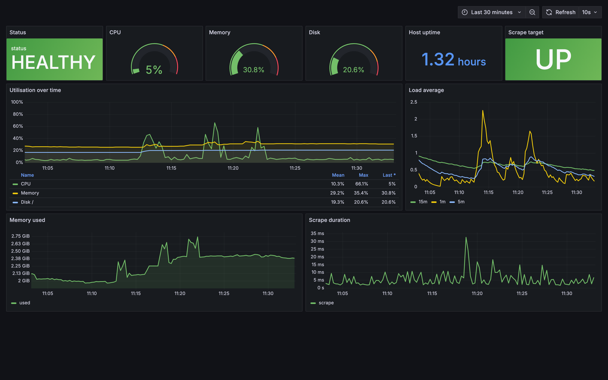

# Cloud Native Monitoring — build, test, ship, run

[](https://github.com/dhaneshab4/CI-CD-pipeline/actions/workflows/ci.yml)

A small Python service that reports host metrics over HTTP, JSON and Prometheus,
plus the entire platform that builds, ships and runs it. The service is
deliberately simple; the point of the repository is everything else — the
multi-stage image, the CI/CD pipeline, the supply-chain hardening, the
Terraform-provisioned AWS estate, and the GitOps loop that keeps the cluster
matching `main`.

| GitOps reconciliation | Canary rollout | Observability |
| --- | --- | --- |
|  |  |  |

**Terraform** provisions VPC, EKS, ECR and IRSA. **Argo CD** owns everything
running on the cluster. **GitHub Actions** and **Jenkins** build and prove the
artifact but never touch the cluster — the deploy is a commit, and Argo CD
converges. See [docs/architecture.md](docs/architecture.md) for why that split
is the whole point.

```
                  ┌──────────────┐   scrape /metrics   ┌──────────────┐
   browser ──────▶│     app      │◀────────────────────│  Prometheus  │
                  │  Flask/gunicorn                    │   + alerts   │
                  │  psutil       │                    └──────┬───────┘
                  └──────────────┘                            │ query
                                                       ┌──────▼───────┐
                                                       │   Grafana    │
                                                       └──────────────┘
```

## Quick start

```bash
make setup      # virtualenv + dev dependencies
make test       # 22 tests
make run        # http://localhost:5000

make up         # app + Prometheus + Grafana via Docker Compose
make down
```

| Service | URL |
| --- | --- |
| Dashboard | http://localhost:5000 |
| Prometheus | http://localhost:9090 |
| Grafana | http://localhost:3000 |

## Endpoints

| Path | Purpose |
| --- | --- |
| `/` | Dashboard; polls the JSON API, no build step, dark mode |
| `/api/metrics` | JSON snapshot. Returns **503** when a threshold is breached |
| `/metrics` | Prometheus exposition format |
| `/healthz` | Liveness — is the process answering |
| `/readyz` | Readiness — can it *actually* collect a metric |

`/healthz` and `/readyz` are separate on purpose. A process can be alive and
still useless: if `/proc` is unreadable the app answers HTTP but cannot collect
anything. Liveness stays green so the orchestrator does not pointlessly restart
it; readiness goes red so traffic stops arriving.

## Configuration

Every value has a working default — the app runs with no configuration at all.

| Variable | Default | Meaning |
| --- | --- | --- |
| `APP_PORT` | `5000` | Listen port |
| `CPU_WARN_PERCENT` | `80` | CPU threshold for degraded status |
| `MEM_WARN_PERCENT` | `80` | Memory threshold |
| `DISK_WARN_PERCENT` | `85` | Disk threshold |
| `DISK_PATH` | `/` | Filesystem to measure |
| `SAMPLE_INTERVAL_SECONDS` | `5` | Dashboard poll interval |
| `LOG_LEVEL` | `INFO` | Log verbosity |

Invalid values fail at startup with a clear message rather than silently
falling back to a default — a typo in `CPU_WARN_PERCENT` should not quietly
disable alerting.

## The image

Multi-stage. The builder installs into a virtualenv and the runtime copies only
that virtualenv, so the C toolchain `psutil` needs to compile never reaches
production.

- Dependencies are installed **before** the source is copied, so an application
  change reuses the dependency layer instead of reinstalling every package
- Runs as a non-root user with a **fixed uid/gid (10001)** so ownership is
  predictable across bind mounts and hosts
- `HEALTHCHECK` probes `/readyz`, not `/healthz` — it should fail when the app
  is useless, not only when it is dead. Implemented with `urllib` so `curl`
  does not have to be installed
- Exec-form `CMD` so gunicorn is PID 1 and receives `SIGTERM` directly
- Compose runs it `read_only` with `no-new-privileges` and a tmpfs for `/tmp`

## The pipeline

`.github/workflows/ci.yml` — six jobs, gated in that order.

| Job | What it does |
| --- | --- |
| **lint** | `ruff check` and `ruff format --check` |
| **test** | pytest across Python 3.11, 3.12 and 3.13, coverage floor 90% |
| **validate-config** | `promtool check config` and `check rules` — a broken alert rule fails the build, not the on-call |
| **validate-manifests** | `kubeconform -strict` over `deploy/k8s/`, with CRD schemas so the ServiceMonitor is checked too |
| **build** | Buildx with GHA layer cache → **load locally and smoke-test first** → Trivy scan (SARIF to the Security tab) → multi-arch push to GHCR → cosign signature and SBOM attestation |
| **integration** | Brings the whole Compose stack up, waits for the container to report *healthy*, asserts Prometheus actually has the target `up`, checks Grafana's health endpoint |

Two details worth calling out:

**The image is smoke-tested before it is pushed.** It is loaded into the local
daemon, started, and probed on every endpoint — including a check that it really
is running as uid 10001. A broken image never reaches the registry.

**The integration job asserts the scrape works**, not just that the containers
started. `docker compose up` succeeding proves very little; querying
`up{job="monitoring-app"} == 1` proves Prometheus can actually reach the target.

Concurrency is set so a second push to a branch cancels the first.

### Supply chain

Every pushed image is signed with **cosign** using keyless OIDC — no private key
to store or rotate — and an **SPDX SBOM** is generated and attested to the same
image.

Both operate on the **digest**, not a tag. Tags are mutable: a tag signed today
can be repointed at a different image tomorrow, and the signature would still
appear valid. The digest cannot.

```bash
cosign verify ghcr.io/dhaneshab4/cloud-native-monitoring-app:latest \
  --certificate-identity-regexp 'https://github.com/dhaneshab4/CI-CD-pipeline/.*' \
  --certificate-oidc-issuer https://token.actions.githubusercontent.com
```

Dependabot watches pip, Docker base images and the Actions themselves, grouped
so it opens one PR per ecosystem rather than a dozen.

## The platform

### Infrastructure — Terraform

`infra/terraform/` provisions the AWS side. `bootstrap/` creates the versioned,
encrypted S3 bucket and DynamoDB lock table for state, and is the one stack
applied by hand. `envs/dev/` then builds the estate:

| | |
| --- | --- |
| **VPC** | Public/private subnets across 2–3 AZs, single NAT by default (~£30/mo cheaper), subnets tagged so the load balancer controller can discover them |
| **EKS** | Managed node group on spot by default, gp3 encrypted root volumes, `api` and `audit` control-plane logs, addons for CoreDNS, kube-proxy, VPC CNI, pod identity and the EBS CSI driver |
| **ECR** | `IMMUTABLE` tags, scan-on-push, lifecycle policy expiring untagged layers after 7 days and keeping the last 20 releases |
| **IAM** | IRSA roles for the EBS CSI driver, External Secrets and the app itself — no static keys anywhere |

The app's IRSA role starts with **no permissions**. That is deliberate: additions
become reviewable diffs rather than a role that quietly accumulates access.

```bash
make tf-init && make tf-plan     # no credentials needed for fmt/validate in CI
make tf-apply                    # ~$110-150/month; destroy when idle
```

### Delivery — Argo CD

`gitops/` holds an app-of-apps. Two `kubectl apply` commands bootstrap a cluster
(see [gitops/bootstrap/README.md](gitops/bootstrap/README.md)); after that,
adding a component is a pull request.

| Application | Namespace | Sync |
| --- | --- | --- |
| `kube-prometheus-stack` | `observability` | automated, self-healing |
| `argo-rollouts` | `argo-rollouts` | automated, self-healing |
| `monitoring-app-dev` | `monitoring-dev` | automated, prune + self-heal |
| `monitoring-app-prod` | `monitoring-prod` | **manual** — the gate is a human |

An `AppProject` scopes the blast radius: only this repo and two upstream chart
repos are permitted as sources, destinations are restricted to four namespaces,
and cluster-scoped kinds are whitelisted explicitly. A sync window blocks
unattended production syncs from Friday evening through the weekend.

The demonstration that matters is not that it deploys but that it **corrects**:

```bash
make selfheal   # scales dev to 5 by hand; Argo puts it back to 1 within ~60s
```

### Packaging — Helm

`charts/monitoring-app/` replaces the raw manifests with one chart and two values
files. The pod spec lives in a single `_helpers.tpl` template shared by both the
Deployment and the Rollout, so the two delivery modes cannot drift apart.

`rollout.enabled` swaps a plain Deployment for an Argo Rollouts canary. Dev
renders a Deployment; prod renders a Rollout stepping 10% → 34% → 67% → 100%
with an optional Prometheus success-rate analysis that aborts the rollout
automatically. Without that analysis a canary is just a slow bad deploy.

```bash
make helm-lint     # both environments
make helm-diff     # what actually differs between dev and prod
```

### Jenkins

`Jenkinsfile` runs the same gates as GitHub Actions, then does the one thing
Actions deliberately does not: it writes the promotion commit. Build → scan →
sign → attest → bump `values-dev.yaml` → wait for Argo to converge → **manual
approval** → bump `values-prod.yaml` → watch the canary finish.

The deploy stage is a `git commit`, not a `kubectl apply`. So the cluster state
is whatever `main` says, even when Jenkins is offline.

## Deployment

Four paths, all in `deploy/` and `charts/`.

**Containers** — `docker compose up -d`. Prometheus and Grafana are provisioned
from files — datasource *and* a ten-panel dashboard — so the stack comes up with
graphs already drawn and nothing to click.

**Kubernetes** — `kubectl apply -k deploy/k8s/`. Two replicas, `maxUnavailable: 0`
so a rollout never drops below the current count, a PodDisruptionBudget, resource
requests and limits, and a locked-down `securityContext` (non-root, read-only
root filesystem, all capabilities dropped, `RuntimeDefault` seccomp).

The three probes do different jobs: `startupProbe` gives a slow start up to 60s
without a lenient liveness threshold, `livenessProbe` hits `/healthz` so a
*degraded* pod is not killed, and `readinessProbe` hits `/readyz` so a pod that
cannot collect metrics is pulled out of the Service instead. A `ServiceMonitor`
is included for clusters running the Prometheus Operator; it is inert elsewhere.

**Bare metal / VM** — `deploy/monitoring-app.service` is a hardened systemd unit:
ordered after `network-online.target`, dedicated non-login service user,
`EnvironmentFile` for secrets, `Restart=always` with a backoff, and a lockdown
block (`ProtectSystem=strict`, `NoNewPrivileges`, `MemoryDenyWriteExecute`,
`SystemCallFilter=@system-service`) because the service reads `/proc` and needs
essentially nothing else.

`deploy/ansible/playbook.yml` provisions a Debian/Ubuntu host end to end —
packages, service account, checkout, virtualenv, unit file, enable, and then
polls `/readyz` until it answers 200. Handlers mean a re-run only restarts the
service if something actually changed.

## Alerting

`deploy/alerts.yml` — high CPU, high memory, disk almost full, application
self-reported degraded, and target down. All have a `for:` duration so a single
scrape spike does not page anyone.

## Layout

```
app/            config.py  metrics.py  main.py  templates/
tests/          22 tests — API contracts, collection, config failure modes

infra/terraform/
  bootstrap/                        S3 state bucket + DynamoDB lock (applied once, by hand)
  modules/ecr/                      immutable tags, scan-on-push, lifecycle policy
  envs/dev/                         VPC + EKS + ECR + IRSA roles

charts/monitoring-app/              Helm: Deployment or Rollout, HPA, PDB, ServiceMonitor
  values.yaml values-dev.yaml values-prod.yaml

gitops/
  bootstrap/                        AppProject + app-of-apps root
  apps/                             Prometheus stack, Rollouts, app per environment

deploy/
  prometheus.yml  alerts.yml        scrape config and five alert rules
  grafana/                          provisioned datasource + 10-panel dashboard
  monitoring-app.service            hardened systemd unit
  ansible/  playbook.yml            host provisioning
            ops-host.yml            pinned DevOps toolchain for a build host
  k8s/                              kustomize (the pre-Helm path, kept working)

local/kind-cluster.yaml             3-node local cluster, ports mapped to the host
.github/workflows/  ci.yml          app: lint, test, validate, build, sign, integrate
                    infra.yml       platform: terraform, tflint, checkov, helm, gitops, ansible
Jenkinsfile                         the same gates, plus the promotion commit
docs/           architecture.md  screenshots.md  img/
Dockerfile      multi-stage, non-root, healthchecked
Makefile        make help
```

## Local development

```bash
make setup
make lint       # ruff
make cov        # tests with the 90% floor enforced
make fmt        # autoformat and autofix
make build      # build the image
make scan       # Trivy, HIGH and CRITICAL only
make k8s        # kubectl apply -k deploy/k8s/
make k8s-check  # kubeconform, the same check CI runs
make verify     # everything CI checks, locally
```

### Running the whole platform locally

The full GitOps loop runs on a laptop for free. Only the Terraform layer needs
AWS; everything above it is identical on `kind`.

```bash
make tools      # kind, kubectl, helm, terraform, argocd, yq, kubeconform
make platform   # kind cluster + Argo CD + the app-of-apps root
make argo-ui    # https://localhost:8081  (password: make argo-password)
```

Give the root application a few minutes — it installs the Prometheus operator
and the Rollouts controller before the app itself, ordered by sync wave.

| | |
| --- | --- |
| App | http://localhost:8080 |
| Argo CD | https://localhost:8081 |
| Grafana | NodePort 30082 |

```bash
make selfheal        # scale by hand, watch Argo CD revert it
make rollout-watch   # follow the production canary
make kind-down       # tear it all down
```

`make tools` uses Homebrew. If it fails on permissions, either
`sudo chown -R $(whoami) /opt/homebrew` or install the binaries directly from
each project's releases page.

## Licence

MIT
